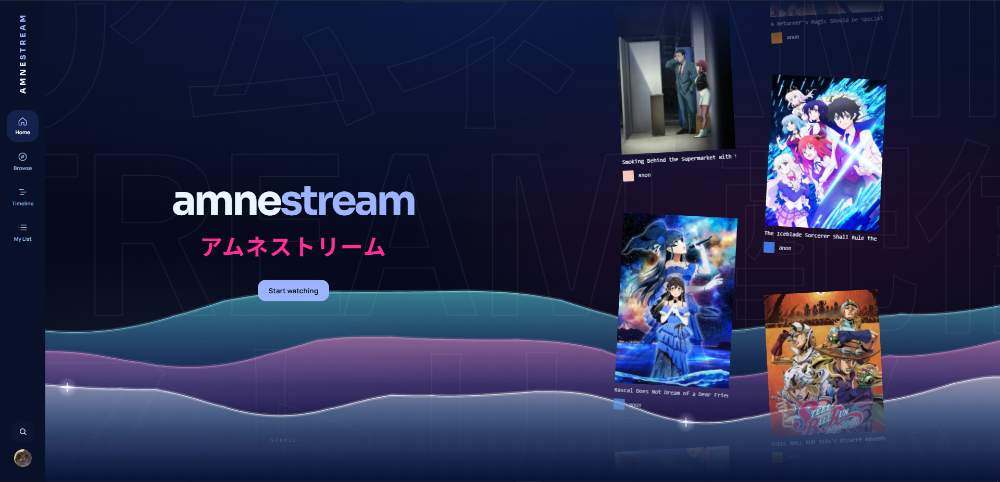
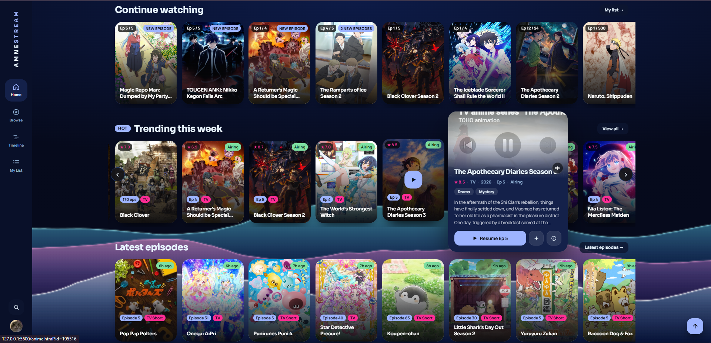
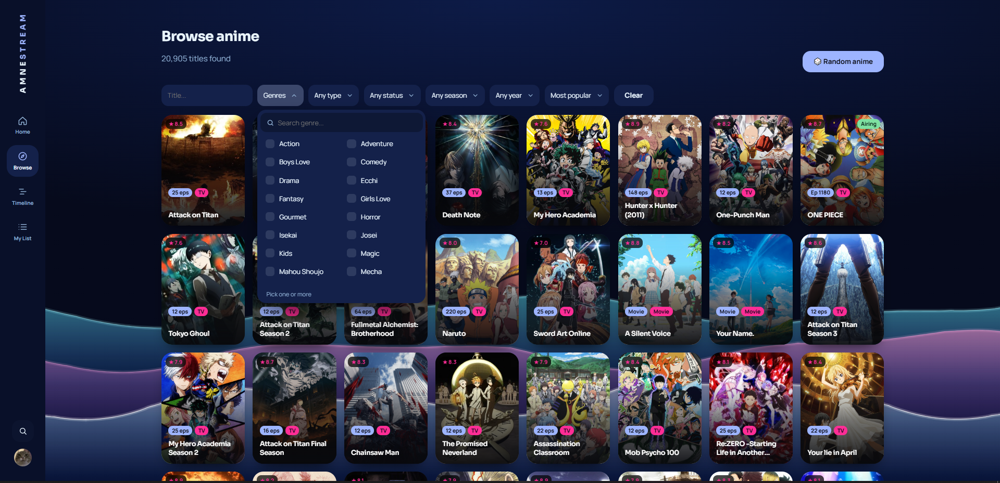
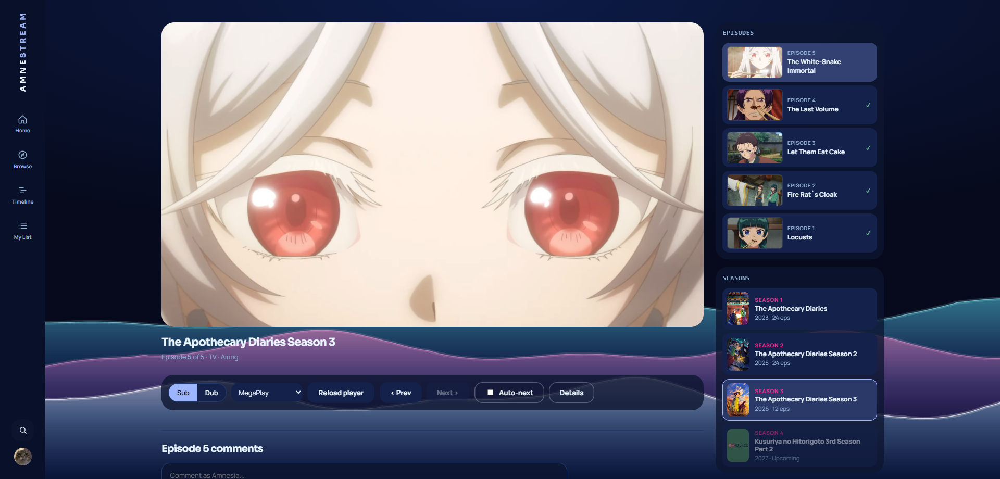

<div align="center">

# amnestream.

**A fast, themeable anime streaming site with sub / dub, server failover and optional cloud sync.**
No backend, no build step: plain HTML, CSS and JavaScript.




</div>

> [!NOTE]
> Amnestream does not host any video. Episodes are embedded from third-party players, and titles and artwork come from the public [AniList](https://anilist.co) API. See the [disclaimer](#disclaimer).

> [!TIP]
> If a server shows an error, use the server dropdown on the watch page or press **Reload player**. The site also fails over to the next server on its own.

## Screenshots

|                                          Home                                          |                               Browse                               |
| :------------------------------------------------------------------------------------: | :----------------------------------------------------------------: |
|  |  |

<div align="center">

</div>

## Features

- **Browse and search** about 20,000 titles, with filters for genre, type, status, season and year. Pick two genres and the results are ranked by how well they match both.
- **Watch** with Sub or Dub, several servers, automatic failover, auto-next, and per-episode comments. Dub is detected per episode, so missing dubs are crossed out.
- **Episode lists your way:** Cards, Compact or Numbers, first-to-latest or latest-first, with real episode previews and titles. Works the same on the details page and the watch page.
- **Seasons row** on every show: every season, movie and OVA in order.
- **Continue watching,** My List, favourites, watch history and an airing **timeline**.
- **18 themes and 8 colour presets** (Retro 96, Cyberpunk, Wave, Voxel, Terminal, Parchment, Pea LCD and more), plus a custom accent colour and a photo background.
- **Works on any device.** Phones get a bottom navigation bar and layouts built for small screens; the PWA installs like an app.
- **Optional account** (Supabase) to sync your list and progress across devices, or move them with a sync code and no account.
- **Private by default:** settings, list and history live in your browser. Incognito mode pauses history.

## Run it

Quickest: open `index.html` in a browser. Recommended (the service worker and baked catalog need `http://`, not `file://`):

```bash
# Python
python3 -m http.server 8080

# or Node
npx serve .
```

Then open <http://localhost:8080>. There is nothing to install or build.

| Windows                  | Linux / macOS                 |
| :----------------------- | :---------------------------- |
| `py -m http.server 8080` | `python3 -m http.server 8080` |

**Accounts and sync (optional).** Create a Supabase project, put its Project URL and public anon key in `js/config.js`, then run the SQL files in `supabase/` once each in the Supabase SQL editor. Both values are public by design; data is protected by row-level security rules.

## Project layout

| Path                                                            | What it is                                                                                                       |
| :-------------------------------------------------------------- | :--------------------------------------------------------------------------------------------------------------- |
| `index.html`, `browse.html`, `anime.html`, `watch.html`         | Home, Browse, Details and the Player                                                                             |
| `mylist.html`, `timeline.html`, `profile.html`, `settings.html` | Your list, airing timeline, profile and settings                                                                 |
| `js/`                                                           | Vanilla JavaScript: `api.js` (AniList, caching), `common.js` (shared helpers, settings, sync), one file per page |
| `css/`                                                          | `style.css` base, `atlas.css` and `me.css` page styles, `mobile.css` phone layer, `themes.css` every theme       |
| `data/catalog.json`                                             | Pre-baked catalog for an instant first paint                                                                     |
| `sw.js`, `manifest.webmanifest`, `icons/`                       | PWA shell                                                                                                        |
| `docs/`                                                         | [DMCA policy](docs/DMCA.md)                                                                                      |

## Built with

| Part                | Tech                                                            |
| :------------------ | :-------------------------------------------------------------- |
| Pages and logic     | HTML, CSS and vanilla JavaScript. No framework, no npm packages |
| Catalog data        | AniList GraphQL API                                             |
| Episode previews    | AniList, then [ani.zip](https://ani.zip) when AniList has none  |
| Video               | Third-party embedded players in an `<iframe>`                   |
| Accounts and sync   | Supabase Auth plus a `user_data` table                          |
| Install and offline | Service worker and web app manifest                             |

## Known limits

- AniList rate limits (about 90 requests a minute per IP) mean heavy browsing can briefly slow results.
- Video depends entirely on third-party providers, which can go down or change URLs without notice. That is why the server list and failover exist.
- Dub availability is detected, not guaranteed.
- Episode previews depend on AniList and ani.zip. Very new or obscure shows may only show the anime's artwork.
- The animated themes (RGB, Wave, Void) redraw constantly and can be slow on older devices. Settings warns about them.

## Disclaimer

Amnestream is not affiliated with AniList, MegaPlay, MegaVid, Anixo or any studio, publisher or streaming service. It does not host, upload or store any video files. Titles, artwork and trademarks belong to their owners.

If you are a copyright owner and want something removed, read the **[DMCA policy](docs/DMCA.md)** (also on the site as [`dmca.html`](dmca.html)) and email **m4cky5467@gmail.com**. Please do not post notices as public issues.

## MyAnimeList tracking

Visitors can log in with MyAnimeList (Settings > MyAnimeList) and their MAL list is kept in step with what they watch: finishing an episode marks it watched (and sets Watching / Completed), and every anime with a MAL id has a MAL panel on its details page for status, episodes and score.

1. On MyAnimeList open **Profile > Account Settings > API > Create ID**. Choose App Type **other** (no secret) or **web**. Set the App Redirect URL to exactly `https://YOUR-SITE/settings.html` (use the same address you serve the site from).
2. In Vercel > Settings > Environment Variables add `MAL_CLIENT_ID` = your Client ID, then redeploy. The site fetches it from `/api/config`, so the ID is not stored in the repo and `malClientId` in `js/config.js` stays empty.
3. Deploy on Vercel with the **Amnestream folder as the project root** so the `api/` folder becomes two serverless functions (`/api/mal-token`, `/api/mal` and `/api/config`). MAL does not allow browsers to call it directly, so these forward the calls. If you registered the app as **web**, also add `MAL_CLIENT_SECRET` there.
4. Without `MAL_CLIENT_ID` the MAL features stay hidden.

Tokens are stored in the visitor's browser only. The functions keep nothing and only forward the few calls listed in `api/mal.js`.

## Usernames

A username is fixed when the account is registered. The site no longer lets it be edited. To enforce it on the server as well, run `supabase/lock-username.sql` once in the Supabase SQL editor.

## Comments

Comments are hidden behind a spoiler alert by default. Each visitor can open them for one anime, or turn on Settings > Content and privacy > Show comments to see them everywhere.
